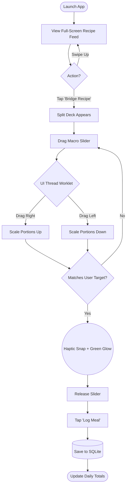
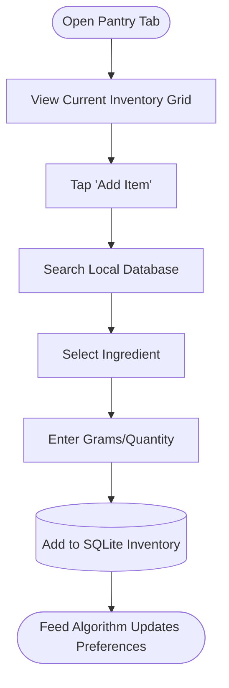

# UX Design Specification CookWiki

**Author:** Ariden
**Date:** 2026-04-01

---

<!-- UX design content will be appended sequentially through collaborative workflow steps -->

## Executive Summary

### Project Vision
CookWiki is an "Active Algorithmic Kitchen Assistant." It abandons the traditional, cluttered recipe-blog format in favor of a 100% offline-first, mathematically reactive interface that dynamically bridges the gap between what a user wants to eat and their daily macro targets.

### Target Users
- **Strict Dieters / Bodybuilders:** Users tracking protein, carbs, and fats to the exact gram.
- **Active Home Cooks:** Users operating in a kitchen environment, often with messy or wet hands, who despise scrolling through walls of text.
- **Data-Driven Planners:** Users who need to visually scan large lists of meals to find the exact nutritional fit rapidly.

### Key Design Challenges
1. **The "Messy Kitchen" Environment:** Operating a mobile device while cooking requires high-contrast typography, strict layout structures, and oversized touch targets (minimum 60x60dp) to prevent mis-taps.
2. **Visualizing Complex Math:** Displaying "Smart Bridging" remaining allowances and "Visual Macro Barcodes" without making the screen look like a confusing, overwhelming spreadsheet.
3. **Latency-Free Perception:** Nailing the 60FPS fluid slider interactions. The user must feel the UI is reacting instantly, hiding the complex SQLite mathematical recalculations running underneath.

### Design Opportunities
1. **The Sliding Recipe View:** Converting the archaic "long scroll" into a fluid, swipeable, step-by-step interactive card system.
2. **Instant Visual Filtering:** Leveraging the offline database to provide zero-latency visual updates across the feed when users filter arrays.
3. **Structured Hierarchy:** Utilizing clear, minimal component guidelines (isolated Primary vs Secondary buttons) to keep cognitive load incredibly low.

## Core User Experience

### Defining Experience
The core action that defines CookWiki is **"Sliding to Bridge."** When a user views a recipe, they interact with a dynamic "Macro Slider." As they physically drag the slider, the underlying ingredient quantities scale in real-time to mathematically bridge the gap between the recipe and the user's remaining daily macro allowance.

### Platform Strategy
- **Primary:** Mobile Application (React Native / Expo).
- **Interaction Model:** Touch-based with continuous gesture tracking via `react-native-reanimated`.
- **Haptic Integration:** Utilizing native device haptics to physically ground algorithmic data points.

### Effortless Interactions
1. **Worklet-Driven Math:** The UI math (macro recalculation) occurs entirely on the UI Thread via Reanimated Worklets, ensuring 60FPS without blocking the JS bridge. Database writes only occur on `onSlidingComplete`.
2. **Magnetic Haptics:** The slider automatically "snaps" with a satisfying haptic vibration when the recipe portions perfectly zero-out the user's remaining daily macros.
3. **Binary Pantry Sync:** Swiping an ingredient instantly depletes it from the user's local inventory.

### Critical Success Moments
1. **The "Haptic Zero" Moment:** The exact second the phone vibrates, signaling the user has perfectly bridged their macros for the day without doing a single mental calculation.
2. **The "No-Wait" Filter:** Filtering an index of 10,000 reference recipes by macro-content and seeing the list update instantaneously because SQLite operates strictly offline.

### Experience Principles
- **Math is Invisible, UI is Fluid:** Underlying algorithms must run as pure UI-thread Worklets.
- **Data Should Feel Physical:** Use haptics to communicate invisible thresholds.
- **Offline equals Zero Latency:** No loading spinners for data mutations.

## Desired Emotional Response

### Primary Emotional Goals
1. **Total Empowerment:** The user should feel absolute control over their diet without feeling the immense cognitive burden usually associated with tracking macros.
2. **Instant Relief:** The feeling of "Ah, I *can* eat this meal, I just need to eat exactly *this* amount."

### Emotional Journey Mapping
- **Discovery (First use):** Intrigue and relief ("Wait, it calculates the portions for me?").
- **Core Action (Sliding to Bridge):** Physical delight. The interaction should feel as satisfying as turning a well-machined volume dial on an expensive stereo.
- **Completion (Macros hit zero):** Profound satisfaction and peace of mind. The puzzle of their daily diet has been solved in seconds.
- **Error State (Over-budget):** Acceptance, not frustration. If a recipe fundamentally cannot fit their macros, the app clearly and gently communicates "this won't fit," rather than throwing red alarm bells.

### Micro-Emotions
- **Confidence > Anxiety:** Strict dieters are often anxious about accuracy. CookWiki must project absolute mechanical precision. This is why the 60FPS requirement is emotional, not just technical: if the slider stutters, the user will instinctively doubt the math.
- **Accomplishment > Chore:** Logging food normally feels like a chore. Bridging a recipe should feel like unlocking an achievement.

### Design Implications
- *To build Confidence:* Use high-contrast, structural typography (e.g., Inter or Roboto Mono for digits). Avoid tiny, clustered "spreadsheet" grids.
- *To build Delight:* Utilize aggressive Reanimated spring physics so sliders possess momentum. Integrate satisfying haptic feedback at critical thresholds.
- *To build Relief:* Create a highly distinct, unambiguous "Zero State" (e.g., a glowing border or green checkmark) when the user perfectly bridges their remaining macros.

### Emotional Design Principles
- **"The Math Should Hug You:"** Never present raw nutritional numbers as a chore to be calculated; present them as a puzzle that the machine has already solved for you.
- **"Solid State:"** The application must feel incredibly reliable. Offline-first architecture perfectly supports this by eradicating loading spinners.

## UX Pattern Analysis & Inspiration

### Inspiring Products Analysis
1. **MacroFactor (Target: Data UX & Trust):** The current industry leader for algorithmic diet caching. They succeed by treating the user like an adult—presenting dense data cleanly without childish gamification.
2. **Apple iOS Control Center (Target: Interaction Physics):** The brightness and volume sliders are the gold standard for touch interaction. They possess momentum, rubber-banding, and haptic limits.
3. **TikTok / Shorts (Target: Content Discovery):** The full-screen, vertical swipe feed is the lowest-friction content discovery model ever invented.

### Transferable UX Patterns
1. **The Full-Screen Media Feed (from TikTok):** Instead of a grid of tiny thumbnail rectangles, the Recipe Discovery feed should be full-screen vertical media. The user swipes up to see the next recipe.
2. **The Physics Slider (from Apple):** The "Macro Bridging" slider must utilize Reanimated spring physics to mimic the exact weight and resistance of an iOS Control Center slider.
3. **Dense but Flat Architecture (from MacroFactor):** Actions must be immediately accessible. Finding a recipe and dragging its slider must take exactly 1 tap from the app launch.

### Anti-Patterns to Avoid
1. **The "Confirm to Save" Purgatory:** MyFitnessPal forces users to hit a tiny checkmark to save a food entry. CookWiki must auto-save instantly on slider release (Zero Latency).
2. **Infinite Navigation Stacks:** Avoid burying the core bridging tool 4 screens deep. The app should launch directly into the active meal feed.
3. **Spinner Paralysis:** Never show a loading spinner after adjusting a macro. If calculations are happening, the UI must maintain the illusion of instant readiness.

### Design Inspiration Strategy
**What to Adopt:** The raw physical interaction model of Apple's fluid volume sliders. The immediate, zero-latency feedback loop.
**What to Adapt:** The vertical full-screen swipe feed (TikTok). Instead of mindless entertainment, we layer the algorithmic "Bridging" UI over the bottom third of the screen, creating an *actionable* media feed.
**What to Avoid:** The archaic, multi-step "add food -> search -> enter grams -> click save" loop found in legacy trackers like MyFitnessPal.

## Design System Foundation

### 1.1 Design System Choice
**Custom Design System** utilizing Vanilla React Native `StyleSheet` (or NativeWind if standard utility classes are preferred by the dev team).

### Rationale for Selection
1. **Performance:** The algorithmic "Slide to Bridge" mechanic requires 60FPS Reanimated gesture tracking. Third-party UI Kits (like Tamagui or NativeBase) inject heavy React Context overhead that can cause micro-stutters during continuous gestures.
2. **Aesthetic Control:** CookWiki requires oversized touch targets (60x60dp minimum) and high-contrast typography for the "Messy Kitchen" environment. Custom components allow us to enforce these exact dimensions.

### Implementation Approach
All UI elements will be built as pure, isolated functional components in the `/components/ui/` folder (e.g., `<PrimaryButton>`, `<MacroSlider>`). Absolute positioning and complex styling will be restricted entirely to this folder to maintain code cleanliness.

### Customization Strategy
We will define a centralized `theme.ts` file containing exactly 3 button variants, a strict high-contrast color palette, and a typography scale using a highly legible developer/data font (e.g., Inter or Roboto Mono).

## 2. Core User Experience

### 2.1 Defining Experience
The defining interaction of CookWiki is **"Algorithmic Macro Bridging."** The user never manually types "150g of chicken." Instead, they drag a dominant, screen-spanning slider that dynamically scales the ratio of the recipe's ingredients until it perfectly "bridges" their remaining daily nutritional targets. 

### 2.2 User Mental Model
- **Current Frustration:** Users open MyFitnessPal, guess an ingredient weight, realize they are 15g over their protein target, do mental math, delete the entry, and re-type a new weight. Repeat 5 times per meal.
- **The Shift:** Changing the mental model from "I must log what I am about to eat" to "The app tells me exactly what I *should* eat to hit my goals."

### 2.3 Success Criteria
1. **Zero Mental Math:** The user literally shouldn't have to look at the numbers if they don't want to; the Haptic Feedback will physically tell them when the math is correct.
2. **Absolute Fluidity:** The slider must never stutter. It must run at 60FPS, giving the illusion that the mobile device is a smooth analog dial.
3. **Unambiguous Success:** A distinct visual (Green/Glowing) state that confirms the daily targets are perfectly met.

### 2.4 Novel UX Patterns
We are combining an *Established* pattern (the physical slider from iOS volume/brightness controls) with a *Novel* data-layer (the slider isn't changing 1 variable; it's recalculating a multivariate algorithmic payload across 10 ingredients simultaneously).

### 2.5 Experience Mechanics
- **1. Initiation:** The user discovers a recipe in the TikTok-style vertical feed and taps the prominent "Bridge Recipe" action button.
- **2. Interaction:** A thick, rubber-banding horizontal slider overtakes the bottom third of the screen. As the user drags it right, all ingredient measurements (e.g., "Chicken: 150g -> 162g") scale up in real-time. Above the slider, a "Remaining Daily Macros" bar rapidly approaches zero.
- **3. Feedback:** The phone delivers a sharp, magnetic haptic 'THUD' exactly when the recipe zeroes out their remaining daily macros. The slider briefly turns green. If they drag further, it turns a warning amber.
- **4. Completion:** The user releases their finger. The UI thread Worklet passes the final payload to the JS thread. The user taps "Save," and the SQLite database registers the meal with zero latency.

## Visual Design Foundation

### Color System
- **Theme:** Dual High-Contrast schema (Strict Light/Dark system modes). 
  - *Dark Mode:* Deep slate (`#0F172A`) to minimize artificial kitchen glare.
  - *Light Mode:* Pure white/ice backgrounds to combat direct daytime sun glare.
- **Semantic Mapping:**
  - *Primary Ascent:* Neon Green (`#10B981`) -> Used *exclusively* to indicate a successful "Macro Bridge" (Zero State).
  - *Warning/Error:* Vivid Amber/Red -> Used when dragging the slider over-budget.
  - *Data Colors:* Distinct, color-blind accessible hues for Protein (Blue), Carbs (Yellow), and Fats (Purple).

### Typography System
- **Structural Text:** `Inter` (or system San-Francisco). Clean, neutral, high-legibility sans-serif for recipe names and standard UI labels.
- **Algorithmic Text (Tabular Mode):** We will use the *same* structural sans-serif font for our sliding metrics, but we will strictly apply the `fontVariant: ['tabular-nums']` property to all numeric `<Text>` components. This guarantees fixed-width digits, preventing any horizontal "jitter" or shifting layouts as calculations hit 60FPS.

### Spacing & Layout Foundation
- **The "Messy Kitchen" Grid:** Based on an 8px scale, but aggressively padded.
- **Touch Targets:** Absolute minimum touch target of `60x60dp` (standard Apple HIG is 44x44, but wet/messy hands require a 30% wider margin of error).
- **The "Floating Bridge" Layout:** The top 60% of the screen is vertical scrolling media (the recipe image/video). The bottom 40% is a fixed, frosted-glass "Control Deck" containing the Macro Slider. This grounds the interaction.

### Accessibility Considerations
- **High Contrast Ratios:** Text must pass WCAG AAA (7:1) contrast ratios against both Light and Dark backgrounds, ensuring readability from 3 feet away on a kitchen counter.
- **Redundant Encoding:** Never rely solely on color. The "Over Budget" state must turn amber *and* display a warning icon or haptic pulse.

## Design Direction Decision

### Design Directions Explored
1. The "Algorithm" (Dense Data).
2. The "Immersive Media" (TikTok Tracker).
3. The "Split Deck" (Balanced Approach).

### Chosen Direction
**Direction 3: The "Split Deck" (Balanced Approach)**

### Design Rationale
The Split Deck perfectly balances the emotional goal of "Food Appeal" with the functional goal of "High Contrast Data." 
- The top 45% allows for beautiful, unencumbered food photography, sparking appetite.
- The bottom 55% utilizes a solid slate "Control Deck" background. This creates absolute maximum contrast for the tabular numerals and slider, avoiding the readability issues that occur when overlaying text onto busy background images (as seen in Direction 2). It satisfies both the "Messy Kitchen" visibility constraints and the premium aesthetic goals.

### Implementation Approach
- **Media Header:** A full-bleed `<Image>` or `<Video>` component occupying the top `45%` of screen height.
- **Control Deck:** A rounded-top `<View>` anchored to the bottom `55%` with a solid background color. Contains the Reanimated `<MacroSlider>` and tabular macro data points.

## User Journey Flows

### 1. The Core Loop: Discovery & Bridging
This is the primary action of the application. The user opens the app to find what they should eat and scales it to their chosen input target.

### 2. The Offline Pantry Sync
CookWiki's algorithms need to know what ingredients the user physically owns.

### Flow Optimization Principles
1. **The "One-Tap Bridge":** The core bridging slider is accessible with exactly 1 tap from the moment the app is launched. We do not hide this behind a "add meal -> search" navigation stack.
2. **Unguided Mathematics:** The application never scolds the user. If they drag a recipe to scale up to 7,000 calories, the UI simply scales the numbers cleanly and accurately without flashing warning colors. It is a strictly unbaised computational tool.

## Component Strategy

### Design System Components
**Gap Analysis:** Because we are utilizing Vanilla React Native `StyleSheet` to prevent 3rd-party render overhead, we have **zero** out-of-the-box components. Everything must be built custom.

### Custom Components

#### 1. `<MacroSlider>` (The Core Bridger)
**Purpose:** The single most important UI element in CookWiki. Allows users to scale recipe ratios dynamically.
**Anatomy:** A thick (min `24px` height) horizontal track with an oversized `40x40px` circular thumb.
**Architecture:** Powered purely by `PanGestureHandler`. The numerical value is stored in a Reanimated `SharedValue`. The complex mathematical recalculations of ingredients run natively on the UI Thread via a dedicated Worklet, bypassing the JS bridge entirely.

#### 2. `<TabularText>` (The Data Renderer)
**Purpose:** Renders all changing numeric data (Calories, Macros, Grams) without layout jitter or dropped frames.
**Architecture:** Built utilizing `Reanimated.Text`. The text value is bound directly to a `useDerivedValue` from the UI Thread. `fontVariant: ['tabular-nums']` is strictly enforced to prevent bounding-box shifts.

#### 3. Pure Action Buttons
**Purpose:** Action execution (e.g., "Bridge Recipe", "Log Entry").
**Variants:**
- `<PrimaryButton>`: Solid background. Used only for the main screen action.
- `<SecondaryButton>`: Outlined background.
- `<TertiaryButton>`: Text only. Used for "Cancel" or minimal-impact actions to avoid UI clutter.
**Accessibility:** Must enforce `minHeight: 60` and `minWidth: 60` for hit-registration in messy environments.

### Implementation Roadmap
**Phase 1 - The Core Loop:** `<TabularText>`, `<MacroSlider>`, and `<PrimaryButton>`.
**Phase 2 - The Media Feed:** `<RecipeCard>` (full-screen media overlay).
**Phase 3 - The Pantry:** `<InventoryGrid>` and `<SearchBar>`.

## UX Consistency Patterns

### Button Hierarchy & Interactions
- **Primary:** Solid filled background (`min-width: 60`, `min-height: 60`). Used exclusively for the single most important action on a screen (e.g., "Log Meal", "Bridge Recipe"). 
- **Secondary:** Outlined, high-contrast border. Used for filtering recipes or adding pantry items.
- **Tertiary:** Pure text, no background. Used for "Cancel" or "Settings" to prevent visual clutter on the data-heavy screens.
- *Interaction:* Every button press triggers a light haptic tick.

### Feedback Patterns (Zero Latency Rule)
- **Success:** Triggers a heavy, magnetic haptic 'thump' accompanied by a Neon Green (`#10B981`) color flash. Used when macros perfectly meet the user's target or a meal is saved to SQLite.
- **Loading:** **Banned.** Because the database is 100% offline (SQLite), Loading Spinners and skeleton screens are strictly prohibited. UI mutations must happen instantly.
- **Error/Warning:** Silent, non-intrusive. If an action fails, an inline toast notification appears at the top of the screen (no pop-up modals that block user flow).

### Form & Input Patterns
- **Analog First:** Sliders and gestures are always the primary initial input method.
- **The "Long-Press" Manual Override:** If a user needs to jump to an extreme value (e.g., scaling a recipe up to 4,000g for a family meal prep), they simply **Long Press** the macro number. This instantly swaps the slider for a manual decimal input pad, bypassing the physical slider limit.
- **Strict Numeric Keyboards:** When manual entry is triggered, the OS keyboard must be strictly forced to `keyboardType="decimal-pad"`. Alphabetical keyboards should never appear unless typing a recipe name string.

### Navigation Patterns
- **Flat Bottom-Tab Architecture:** The app primarily uses a bottom tab navigator with three main tabs:
  1. *Recipes (Home):* Feed of recipes with search/filters. Includes a 'Add Recipe' button. Selecting a recipe opens the Recipe Details page (ingredients, quantities, process).
  2. *Ingredients:* List of ingredients and their nutritional values. Includes an 'Add Ingredient' button. Selecting an ingredient opens its specific nutritional details.
  3. *User Profile:* If logged out, displays Login/Register flow. If logged in, displays profile details (name, picture), theme toggle (Light/Dark mode), and Logout.
- **Authentication Gates:** Tapping 'Add Recipe' or 'Add Ingredient' while unauthenticated will automatically redirect the user to the Login/Register flow on the User Profile tab.

## Responsive Design & Accessibility

### Responsive Strategy
CookWiki is designed strictly as a Mobile/Tablet-first utility to be used on kitchen counters.
- **Mobile (Default):** The "Split Deck" orientation (Media on top, Control Deck on bottom). Focus is on 1-handed vertical use.
- **Tablet (Landscape):** Extra screen real-estate changes the paradigm. The "Split Deck" rotates 90 degrees to become a literal "Split Screen" (Recipe media fixed to the left 50%, Control Deck fixed to the right 50%). This avoids horizontally stretched, unreadable lines of text.

### Breakpoint Strategy
- **Compact (0px - 599px):** Standard mobile layout.
- **Regular (600px+):** Triggers the Tablet layout (side-by-side rendering).

### Accessibility Strategy
Based on the physical constraints of cooking (wet hands, distant viewing, glare), CookWiki targets **WCAG AAA Compliance**.
1. **Visual Contrast:** All text must hit a 7:1 contrast ratio against both Light/Dark Slate backgrounds. No low-contrast grey-on-grey "disabled" text; disabled states are indicated by opacity fading to 30%, not color shifting.
2. **Motor Accessibility:** Target zones are mathematically expanded. A visible `40x40px` slider thumb must have an invisible CSS `hitSlop` bounding box of at least `80x80px` to catch imprecise, wet-handed swipes.
3. **Dynamic Type Limits:** The application must support system Font Scaling (`allowFontScaling={true}`), but strictly capped at a `maxFontSizeMultiplier={1.5}` to prevent the highly rigid Macro Slider layout from fatally overlapping or breaking.

### Testing Strategy
- **The "Three-Foot Test":** Device testing must include placing the phone flat on a counter, stepping 3 feet back under direct overhead lighting, and ensuring the Neon Green states are instantly distinguishable.
- **Device Support:** Native rendering tested across iOS (iPhone 13+) and Android (Pixel 6+) to ensure 60FPS Worklet execution is not lagging on mid-tier hardware.
